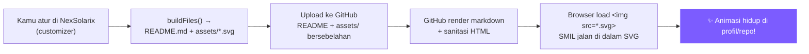
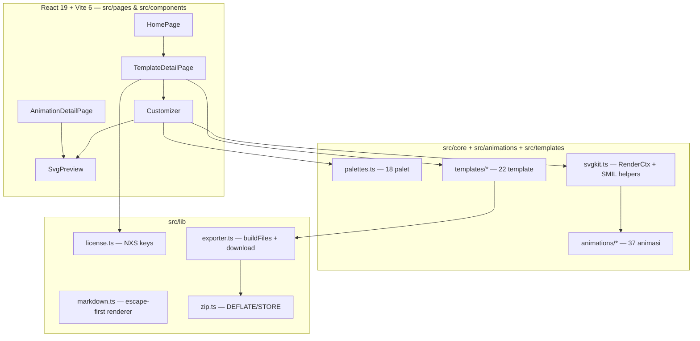

<div align="center">

<!-- ============================================================ -->
<!-- PREMIUM ANIMATED HEADER — SMIL only (works in  on GitHub) -->
<!-- ============================================================ -->
<svg xmlns="http://www.w3.org/2000/svg" width="1280" height="320" viewBox="0 0 1280 320" role="img" aria-label="NexSolarix — premium README studio">
NexSolarix — premium README studio
<defs>
  <linearGradient id="nx-bg" x1="0%" y1="0%" x2="100%" y2="100%">
    <stop offset="0%" stop-color="#05060f"/>
    <stop offset="45%" stop-color="#0d1030"/>
    <stop offset="100%" stop-color="#05060f"/>
  </linearGradient>
  <linearGradient id="nx-g1" x1="0%" y1="0%" x2="100%" y2="100%">
    <stop offset="0%" stop-color="#7c5cff"/><stop offset="45%" stop-color="#35d0ff"/><stop offset="100%" stop-color="#ff5cc8"/>
  </linearGradient>
  <linearGradient id="nx-g2" x1="100%" y1="0%" x2="0%" y2="100%">
    <stop offset="0%" stop-color="#35d0ff"/><stop offset="50%" stop-color="#7c5cff"/><stop offset="100%" stop-color="#ff5cc8"/>
  </linearGradient>
  <linearGradient id="nx-sh" x1="0%" y1="0%" x2="100%" y2="0%">
    <stop offset="0%" stop-color="#fff" stop-opacity="0"/><stop offset="50%" stop-color="#fff" stop-opacity="0.9"/><stop offset="100%" stop-color="#fff" stop-opacity="0"/>
  </linearGradient>
  <filter id="nx-glow" x="-50%" y="-50%" width="200%" height="200%"><feGaussianBlur stdDeviation="8" result="b"/><feMerge><feMergeNode in="b"/><feMergeNode in="b"/><feMergeNode in="SourceGraphic"/></feMerge></filter>
  <filter id="nx-blur" x="-50%" y="-50%" width="200%" height="200%"><feGaussianBlur stdDeviation="22"/></filter>
  <radialGradient id="nx-vig" cx="50%" cy="50%" r="70%"><stop offset="62%" stop-color="#000" stop-opacity="0"/><stop offset="100%" stop-color="#000" stop-opacity="0.55"/></radialGradient>
</defs>
<rect width="1280" height="320" rx="22" fill="url(#nx-bg)"/>
<!-- drifting aurora blobs -->
<circle cx="260" cy="110" r="170" fill="#7c5cff" opacity="0.42" filter="url(#nx-blur)">
  <animate attributeName="cx" dur="11s" repeatCount="indefinite" values="260;320;200;260" calcMode="spline" keyTimes="0;0.33;0.66;1" keySplines="0.42 0 0.58 1;0.42 0 0.58 1;0.42 0 0.58 1"/>
  <animate attributeName="cy" dur="13s" repeatCount="indefinite" values="110;90;135;110" calcMode="spline" keyTimes="0;0.33;0.66;1" keySplines="0.42 0 0.58 1;0.42 0 0.58 1;0.42 0 0.58 1"/>
  <animate attributeName="r" dur="9s" repeatCount="indefinite" values="170;195;160;170"/>
</circle>
<circle cx="780" cy="210" r="190" fill="#35d0ff" opacity="0.30" filter="url(#nx-blur)">
  <animate attributeName="cx" dur="12s" repeatCount="indefinite" values="780;840;700;780"/>
  <animate attributeName="cy" dur="10s" repeatCount="indefinite" values="210;190;230;210"/>
  <animate attributeName="r" dur="11s" repeatCount="indefinite" values="190;210;175;190"/>
</circle>
<circle cx="1020" cy="90" r="150" fill="#ff5cc8" opacity="0.32" filter="url(#nx-blur)">
  <animate attributeName="cx" dur="14s" repeatCount="indefinite" values="1020;980;1080;1020"/>
  <animate attributeName="r" dur="8s" repeatCount="indefinite" values="150;170;140;150"/>
</circle>
<rect width="1280" height="320" rx="22" fill="url(#nx-vig)"/>
<!-- shimmer sweep -->
<g opacity="0.55"><rect x="-380" y="70" width="360" height="180" fill="url(#nx-sh)" transform="rotate(12)"><animateTransform attributeName="transform" type="translate" values="-380 0;1280 0;-380 0" dur="3.8s" repeatCount="indefinite" additive="sum"/><animate attributeName="opacity" dur="3.8s" repeatCount="indefinite" values="0;0.55;0"/></rect></g>
<!-- title -->
<text x="640" y="128" text-anchor="middle" font-family="'JetBrains Mono',Consolas,monospace" font-size="56" font-weight="900" fill="#eef1ff" letter-spacing="10" filter="url(#nx-glow)">NEXSOLARIX</text>
<text x="640" y="168" text-anchor="middle" font-family="Inter,system-ui,sans-serif" font-size="18" font-weight="500" fill="#9aa3c7" letter-spacing="5">STUDIO README &amp; ANIMASI SVG PREMIUM</text>
<line x1="480" y1="188" x2="800" y2="188" stroke="url(#nx-g1)" stroke-width="1.6" opacity="0.9"><animate attributeName="x1" dur="4s" repeatCount="indefinite" values="480;520;480"/><animate attributeName="x2" dur="4s" repeatCount="indefinite" values="800;760;800"/></line>
<text x="640" y="220" text-anchor="middle" font-family="'JetBrains Mono',monospace" font-size="13" font-weight="700" fill="#c4b5fd" letter-spacing="3.5">22 TEMPLATE · 37 ANIMASI · 18 PALET · 0 BACKEND</text>
<g font-family="'JetBrains Mono',monospace" font-size="11" font-weight="600">
  <rect x="462" y="238" width="96" height="28" rx="14" fill="#111634" stroke="#262c55" stroke-width="1.2"/>
  <text x="510" y="257" text-anchor="middle" fill="#8ec3b1">● LIVE</text>
  <rect x="572" y="238" width="112" height="28" rx="14" fill="#111634" stroke="#262c55" stroke-width="1.2"/>
  <text x="628" y="257" text-anchor="middle" fill="#eef1ff">v1.0.0</text>
  <rect x="698" y="238" width="116" height="28" rx="14" fill="url(#nx-g1)"/>
  <text x="756" y="257" text-anchor="middle" fill="#fff">PREMIUM ✦</text>
</g>
</svg>

<br/>

<!-- typing animation (external SVG — animated, works on GitHub) -->
<a href="#-cara-pemasangan--installation">
  
</a>

<p>
  <a href="https://github.com/superrrkyy/nexsolarix"></a>
  <a href="#-sistem-premium--kode-lisensi"></a>
  <a href="#-pengujian"></a>
  <a href="./LICENSE"></a>
  <a href="https://instagram.com/superryinz"></a>
</p>

<p>
  
  
  
  
  
  
  
</p>

**NexSolarix adalah studio web untuk mempercantik profil / repo GitHub: 22 template README siap pakai + 37 animasi SVG yang bisa dikustomisasi langsung di browser, lalu disalin atau diunduh sebagai ZIP lengkap (README.md + file animasi + config + panduan) yang bebas kamu ubah.**

> Semua animasi tetap berjalan di GitHub karena ditaruh **di dalam file SVG**, bukan di markdown — lihat [Mengapa animasinya jalan](#-mengapa-animasinya-jalan-di-github).

[🎨 Buka Studio](https://github.com/superrrkyy/nexsolarix) · [📖 Panduan](#-cara-pemasangan--installation) · [✦ Premium](#-sistem-premium--kode-lisensi) · [🐛 Troubleshooting](#-error--cara-memperbaiki-troubleshooting)

</div>

---

## 📑 Daftar Isi

<details>
<summary><b>Buka daftar isi lengkap (18 bagian)</b></summary>

- [✨ Preview Premium — Animasi Pilihan](#-preview-premium--animasi-pilihan)
- [🎯 Fitur](#-fitur)
- [⚡ Mulai Cepat (30 detik)](#-mulai-cepat-30-detik)
- [📦 Cara Pemasangan — Installation](#-cara-pemasangan--installation)
- [⚙️ Konfigurasi Environment](#️-konfigurasi-environment)
- [🚀 Cara Penggunaan](#-cara-penggunaan)
- [🗂 Struktur Proyek](#-struktur-proyek)
- [🎬 Mengapa Animasinya Jalan di GitHub](#-mengapa-animasinya-jalan-di-github)
- [💎 Sistem Premium & Kode Lisensi](#-sistem-premium--kode-lisensi)
- [🎨 Palet & Kustomisasi](#-palet--kustomisasi)
- [🧩 Source Code — Bongkar Mesinnya](#-source-code--bongkar-mesinnya)
- [⚠️ Efek Samping & Batasan](#️-efek-samping--batasan)
- [🐛 Error & Cara Memperbaiki — Troubleshooting](#-error--cara-memperbaiki-troubleshooting)
- [🚢 Deploy](#-deploy)
- [➕ Menambah Animasi atau Template Baru](#-menambah-animasi-atau-template-baru)
- [🧪 Pengujian](#-pengujian)
- [🤝 Kontribusi](#-kontribusi)
- [📜 Lisensi](#-lisensi)

</details>

---

## ✨ Preview Premium — Animasi Pilihan

NexSolarix punya **37 animasi**: 25 gratis + **12 premium** yang membawa motion design paling berat — parallax berlapis, iridescent, glitch, kinetic, liquid metal, hingga dashboard penuh. Di bawah ini **preview animasi langsung di README** (inline SVG + SMIL, akan jalan di render GitHub):

<div align="center">

### Premium Showcase — 12 Animasi Signature

| Animasi Premium | Vibe | Dipakai di Template |
|---|---|---|
| **Holo Card** | Holografik iridescent + sparkle | `holo-profile` |
| **Aurora Flow** | Kabut gradasi dengan depth-of-field | `aurora-flow-pro` |
| **Cyber Glitch** | RGB split + scanline rusak | `cyber-glitch-pro` |
| **Kinetic Typography** | Huruf mendarat + pita berjalan | `kinetic-pro` |
| **Liquid Metal** | Logam cair + specular sweep | `liquid-lux` |
| **Retro Sun** | Matahari synthwave + grid surut | `retro-iso` |
| **Dashboard Panel** | Cincin, bar, sparkline, status | `dashboard-pro` |
| **Stat Rings Pro** | Orbit marker + pulsing readout | `holo-profile`, `dashboard-pro` |
| **IDE Window** | Sidebar, minimap, status bar | `cyber-glitch-pro` |
| **Particle Depth** | 3 lapisan parallax + link lines | `aurora-flow-pro`, `constellation-pro` |
| **Nebula Clouds** | Awan gas + bintang jatuh | `nebula-pro` |
| **Prism Beam** | Prisma memecah cahaya | `prism-pro` |

</div>

<!-- Animated premium divider 1 — wave -->
<svg xmlns="http://www.w3.org/2000/svg" width="1280" height="56" viewBox="0 0 1280 56" role="img" aria-label="animated wave divider">
<defs>
  <linearGradient id="wv-g" x1="0%" y1="0%" x2="100%" y2="0%"><stop offset="0%" stop-color="#7c5cff"/><stop offset="50%" stop-color="#35d0ff"/><stop offset="100%" stop-color="#ff5cc8"/></linearGradient>
  <filter id="wv-glow" x="-50%" y="-50%" width="200%" height="200%"><feGaussianBlur stdDeviation="2.2"/><feMerge><feMergeNode in="SourceGraphic"/></feMerge></filter>
</defs>
<rect width="1280" height="56" rx="10" fill="#0d1030" opacity="0.85"/>
<g fill="none" stroke="url(#wv-g)" stroke-width="2.2" stroke-linecap="round" filter="url(#wv-glow)" opacity="0.95">
  <path d="M0 28 Q 160 6 320 28 T 640 28 T 960 28 T 1280 28">
    <animate attributeName="d" dur="3.2s" repeatCount="indefinite" values="M0 28 Q 160 6 320 28 T 640 28 T 960 28 T 1280 28;M0 28 Q 160 50 320 28 T 640 28 T 960 28 T 1280 28;M0 28 Q 160 6 320 28 T 640 28 T 960 28 T 1280 28"/>
  </path>
  <path d="M0 36 Q 160 16 320 36 T 640 36 T 960 36 T 1280 36" opacity="0.38" stroke-width="1.4">
    <animate attributeName="d" dur="3.8s" repeatCount="indefinite" values="M0 36 Q 160 16 320 36 T 640 36 T 960 36 T 1280 36;M0 36 Q 160 56 320 36 T 640 36 T 960 36 T 1280 36;M0 36 Q 160 16 320 36 T 640 36 T 960 36 T 1280 36"/>
  </path>
</g>
<circle cx="640" cy="28" r="4" fill="#fff" opacity="0.95"><animate attributeName="r" dur="1.6s" repeatCount="indefinite" values="3;6;3"/><animate attributeName="opacity" dur="1.6s" repeatCount="indefinite" values="0.85;0.35;0.85"/></circle>
</svg>

<div align="center">

<!-- palette row preview -->


</div>

<!-- equalizer micro animation -->
<div align="center">
<svg xmlns="http://www.w3.org/2000/svg" width="520" height="34" viewBox="0 0 520 34" role="img" aria-label="equalizer preview">
<defs><linearGradient id="eq-g" x1="0%" y1="0%" x2="100%" y2="0%"><stop offset="0%" stop-color="#7c5cff"/><stop offset="100%" stop-color="#35d0ff"/></linearGradient></defs>
<rect width="520" height="34" rx="17" fill="#111634" stroke="#262c55"/>
<g fill="url(#eq-g)">
  <rect x="18" y="10" width="14" height="14" rx="3"><animate attributeName="height" dur="0.9s" repeatCount="indefinite" values="6;18;9;14;6"/><animate attributeName="y" dur="0.9s" repeatCount="indefinite" values="18;8;15;10;18"/></rect>
  <rect x="38" y="10" width="14" height="14" rx="3"><animate attributeName="height" dur="1.1s" repeatCount="indefinite" values="14;6;16;8;14"/><animate attributeName="y" dur="1.1s" repeatCount="indefinite" values="10;18;8;14;10"/></rect>
  <rect x="58" y="10" width="14" height="14" rx="3"><animate attributeName="height" dur="0.8s" repeatCount="indefinite" values="9;15;5;12;9"/><animate attributeName="y" dur="0.8s" repeatCount="indefinite" values="15;7;19;10;15"/></rect>
  <rect x="78" y="10" width="14" height="14" rx="3"><animate attributeName="height" dur="1.0s" repeatCount="indefinite" values="12;7;17;10;12"/><animate attributeName="y" dur="1.0s" repeatCount="indefinite" values="11;17;6;10;11"/></rect>
  <rect x="98" y="10" width="14" height="14" rx="3"><animate attributeName="height" dur="0.95s" repeatCount="indefinite" values="7;16;8;13;7"/><animate attributeName="y" dur="0.95s" repeatCount="indefinite" values="17;6;14;10;17"/></rect>
  <rect x="118" y="10" width="14" height="14" rx="3"><animate attributeName="height" dur="1.05s" repeatCount="indefinite" values="15;8;13;6;15"/><animate attributeName="y" dur="1.05s" repeatCount="indefinite" values="7;14;9;18;7"/></rect>
  <rect x="138" y="10" width="14" height="14" rx="3"><animate attributeName="height" dur="0.85s" repeatCount="indefinite" values="8;12;6;18;8"/><animate attributeName="y" dur="0.85s" repeatCount="indefinite" values="14;10;18;6;14"/></rect>
  <rect x="158" y="10" width="14" height="14" rx="3"><animate attributeName="height" dur="1.15s" repeatCount="indefinite" values="10;5;15;9;10"/><animate attributeName="y" dur="1.15s" repeatCount="indefinite" values="12;19;7;13;12"/></rect>
</g>
<text x="210" y="24" font-family="'JetBrains Mono',monospace" font-size="12" font-weight="700" fill="#eef1ff" letter-spacing="2">♫ Now playing — Equalizer live</text>
<circle cx="494" cy="17" r="5" fill="#34d399"><animate attributeName="opacity" dur="1.2s" repeatCount="indefinite" values="1;0.25;1"/></circle>
</svg>
</div>

---

## 🎯 Fitur

<table>
<tr><th>Konten</th><th>Detail</th></tr>
<tr><td><b>22 template</b></td><td>12 gratis + 10 premium (profil, proyek, portofolio, kreatif, minimal, data). Setiap template = <code>README.md</code> + <code>assets/*.svg</code> + <code>nexsolarix.config.json</code> + <code>HOW-TO.md</code> bilingual.</td></tr>
<tr><td><b>37 animasi SVG</b></td><td>25 gratis + 12 premium (banner, kartu, data, efek, pemisah). Semua SMIL — jalan di <code>&lt;img&gt;</code> GitHub tanpa script.</td></tr>
<tr><td><b>18 palet</b></td><td>10 gratis + 8 premium signature + input warna aksen bebas. Kontras dicek per palet.</td></tr>
<tr><th>Interaksi</th><th></th></tr>
<tr><td>Kustomisasi live</td><td>Palet, aksen, ukuran, kecepatan, kerapatan, radius, font (5), perataan, glow, transparan, semua teks.</td></tr>
<tr><td>Preview mirip GitHub</td><td>Frame terang/gelap real-time, toggle tema global, PWA + service worker (offline).</td></tr>
<tr><td>Ekspor</td><td>Salin README, salin SVG per aset, unduh README saja, atau <b>ZIP lengkap</b>. Mode tautan: relatif (<code>./assets/</code>) atau <code>raw.githubusercontent</code>.</td></tr>
<tr><td>Navigasi</td><td>Command palette <code>⌘K / Ctrl+K</code>, pencarian, filter tier/kategori/grup, sort, shuffle, favorit (localStorage).</td></tr>
<tr><td>Bilingual + theming</td><td>Indonesia / English toggle, light/dark, PWA, no tracking.</td></tr>
<tr><th>Teknis</th><th></th></tr>
<tr><td>Stack</td><td>React 19 + Vite 6 + TypeScript strict. Tanpa backend, DB, API key.</td></tr>
<tr><td>ZIP writer</td><td>Penulis ZIP sendiri pakai <code>CompressionStream('deflate-raw')</code> fallback <code>STORE</code> — nol dependency.</td></tr>
<tr><td>Tes</td><td><b>358 tes</b>: validasi SVG (<code>url(#id)</code> resolve, tanpa <code>&lt;script&gt;</code>, durasi valid), audit tata letak, ZIP+CRC32, policy salin/unduh, licence, smoke halaman, runtime jsdom, i18n.</td></tr>
</table>

---

## ⚡ Mulai Cepat (30 Detik)

Butuh **Node.js 20+** (cek `node -v`). Tidak perlu database, tidak perlu API key.

```bash
# 1) Clone
git clone https://github.com/superrrkyy/nexsolarix.git
cd nexsolarix

# 2) Install & jalan
npm install
npm run dev          # → http://localhost:5173  (host 0.0.0.0, buka dari HP satu Wi-Fi juga bisa)

# 3) Build produksi
npm run build        # typecheck + vite build → dist/
npm run preview      # preview hasil build di http://localhost:4173
```

<details>
<summary><b>Perintah lain (klik untuk buka)</b></summary>

```bash
npm run typecheck    # TypeScript strict
npm test             # 358 tes (vitest run)
npm run test:watch   # vitest watch
npm run audit:layout # audit tata letak teks semua animasi + template
npm run samples      # render semua aset ke ./samples untuk diperiksa
npm run zips         # tulis ZIP sungguhan per template ke ./samples/zips
```

</details>

> 💡 **Preview di HP?** Dev server bind `0.0.0.0`. Buka `http://<IP-laptop-kamu>:5173` dari HP yang satu jaringan — tidak perlu tunnel.

---

## 📦 Cara Pemasangan — Installation

### Prasyarat

| Kebutuhan | Versi | Cara cek | Catatan |
|---|---|---|---|
| **Node.js** | `>=20` (rekomendasi 20 LTS / 22 LTS) | `node -v` | Proyek pakai `es2022` + `CompressionStream`. Node 18 masih jalan dev, tapi ZIP compress bisa fallback ke STORE. |
| **npm** | `>=10` (ikut Node 20) | `npm -v` | Bisa pakai `pnpm`/`yarn`/`bun`, tapi `package-lock.json` untuk `npm ci` di CI. |
| **Git** | terbaru | `git --version` | Untuk clone & deploy Pages. |
| **Browser modern** | Chrome 110+, Firefox 115+, Safari 17+ | — | Dibutuhkan untuk `CompressionStream` saat unduh ZIP. Fallback tetap ada. |
| **OS** | Windows / macOS / Linux | — | Tidak ada native dependency. |

### Opsi A — Clone & Dev (paling umum)

```bash
git clone https://github.com/superrrkyy/nexsolarix.git
cd nexsolarix
npm install            # atau npm ci untuk reproducible
npm run dev
# buka http://localhost:5173
```

Ubah `.env` kalau perlu (lihat [Konfigurasi](#️-konfigurasi-environment)), lalu refresh — Vite HMR otomatis.

### Opsi B — Fork + GitHub Pages (1 klik deploy)

1. Fork repo ini di GitHub.
2. Aktifkan **Settings → Pages → Source: GitHub Actions**.
3. Push ke `main` — workflow `.github/workflows/deploy-pages.yml` akan build & deploy otomatis.
4. URL jadi `https://<username>.github.io/nexsolarix/` (base sudah di-handle `public/404.html` + `VITE_BASE`).

Manual build untuk Pages:

```bash
VITE_BASE=/nexsolarix/ npm run build
# upload isi dist/ ke gh-pages branch, atau pakai workflow yang sudah ada
```

### Opsi C — Vercel / Netlify / Cloudflare Pages (SPA statis)

Semua platform ini sudah dikonfigurasi:

- **Vercel** → import repo, auto-detect Vite. `vercel.json` sudah ada (`rewrites` + `Cache-Control` untuk `/assets/*`).
- **Netlify** → connect repo, build `npm run build`, publish `dist`. `netlify.toml` sudah ada (`[[redirects]]` SPA + headers).
- **Cloudflare Pages** → build `npm run build`, output `dist`, no extra config.

Semua output adalah **static** — tidak ada SSR, tidak ada serverless function wajib.

### Opsi D — Docker (opsional, tidak wajib)

Kalau kamu butuh container:

```dockerfile
# Dockerfile (contoh)
FROM node:22-alpine AS build
WORKDIR /app
COPY package*.json ./
RUN npm ci
COPY . .
RUN npm run build

FROM nginx:alpine
COPY --from=build /app/dist /usr/share/nginx/html
COPY nginx.conf /etc/nginx/conf.d/default.conf
# nginx.conf harus rewrite /* → /index.html untuk SPA
```

```bash
docker build -t nexsolarix .
docker run -p 8080:80 nexsolarix
```

### Opsi E — Tanpa install (pakai ZIP dari GitHub)

1. Buka halaman repo → **Code → Download ZIP**.
2. Ekstrak, buka `dist/index.html` **tidak akan jalan** (butuh server). Solusi: jalankan server statis kecil:

```bash
npx serve dist
# atau: python -m http.server --directory dist 8000
```

> Rekomendasi tetap **Opsi A** — dev server Vite jauh lebih cepat + HMR.

### Verifikasi instalasi berhasil

Centang ini setelah `npm run dev`:

- [ ] Browser membuka `http://localhost:5173` tanpa error putih
- [ ] Halaman **Home** menampilkan 22 template & 37 animasi
- [ ] Buka satu template → preview README mirip GitHub muncul, ubah palet → preview update real-time
- [ ] Tombol **Salin** dan **Unduh ZIP** berfungsi (cek `dist/` setelah build)
- [ ] `npm test` → `358 passed`, `npm run typecheck` → no error, `npm run build` → `dist/index.html` ada

Jika ada yang gagal, langsung ke [Troubleshooting](#-error--cara-memperbaiki-troubleshooting).

---

## ⚙️ Konfigurasi Environment

Salin `.env.example` → `.env.local` (Vite hanya baca file yang prefix `VITE_`):

```bash
cp .env.example .env.local
# edit .env.local
```

| Variabel | Wajib? | Default | Fungsi |
|---|---|---|---|
| `VITE_INSTAGRAM_HANDLE` | ❌ | `superryinz` | Handle Instagram owner untuk CTA premium. Tanpa `@`. |
| `VITE_LICENSE_SECRET` | ❌ | *(demo secret)* | Secret untuk sign kode lisensi. Kosong = pakai demo secret (tidak aman untuk produksi — siapa pun bisa generate kode). Isi dengan string panjang acak untuk deploy privat. |
| `VITE_SITE_URL` | ❌ | `""` | URL absolut situs untuk tag canonical/OG (mis. `https://nexsolarix.vercel.app`). |
| `VITE_BASE` | ❌ | `/` | Base path saat host di sub-folder (mis. `/nexsolarix/` untuk GitHub Pages). Harus diawali & diakhiri `/`. |

Contoh `.env.local` lengkap:

```ini
VITE_INSTAGRAM_HANDLE=superryinz
VITE_LICENSE_SECRET=kucing-terbang-makan-pizza-2025-ganti-yang-lebih-panjang!
VITE_SITE_URL=https://username.github.io/nexsolarix/
VITE_BASE=/nexsolarix/
```

> 🔐 **Catatan keamanan:** `VITE_*` ikut ter-bundle ke client JS — jangan taruh secret sensitif (API key berbayar, private key). `VITE_LICENSE_SECRET` memang sengaja terlihat di bundle; ini *soft gate* (penjelasan di [Premium](#-sistem-premium--kode-lisensi)). Untuk penegakan keras butuh backend.

---

## 🚀 Cara Penggunaan

### Alur 2-menit: dari nol ke README animasi

1. **Pilih template** di `/templates` → klik kartu → masuk `/templates/:id`
2. **Custom di panel kanan:** palet, aksen, ukuran (W×H), kecepatan, kerapatan, radius, font, align, glow, transparan, title/subtitle/label
3. **Preview** otomatis update — toggle terang/gelap untuk cek kontras
4. **Ekspor:**
   - **Salin README** → paste ke `README.md` repo kamu
   - **Unduh README** → `README.md` saja
   - **Unduh ZIP** → lengkap: `README.md` + `assets/*.svg` + `nexsolarix.config.json` + `HOW-TO.md`
   - **Salin SVG** per aset di tab Assets
5. **Upload ke GitHub:** ekstrak ZIP, upload semua file ke repo (pastikan `assets/` di sebelah `README.md`), commit, refresh — animasi langsung jalan

### Mode tautan aset

| Mode | Kapan dipakai | Jalur di README |
|---|---|---|
| **Relatif** (`./assets/...`) | README & aset di repo yang sama (paling umum) | `` |
| **Raw URL** | Aset di repo `A`, README di repo `B` (mis. single source of truth untuk banyak profil) | `` |

Ganti mode di dropdown **Asset links** pada halaman detail template.

### Pintasan yang wajib tahu

- `⌘K` / `Ctrl+K` → Command palette (lompat ke template/animasi/halaman)
- Klik **♡** di kartu untuk favorit (tersimpan di `localStorage`)
- **Share** → salin URL dengan config ter-encode (bisa kirim ke teman, dia buka langsung lihat setting kamu)

---

## 🗂 Struktur Proyek

```text
nexsolarix/
├─ public/
│  ├─ 404.html              SPA fallback untuk GitHub Pages / hosting statis tanpa rewrite
│  ├─ favicon.svg
│  ├─ manifest.webmanifest  PWA manifest
│  └─ sw.js                 Service worker (offline cache)
├─ src/
│  ├─ core/
│  │  ├─ types.ts           Domain types: RenderConfig, AnimationAsset, TemplateAsset, Palette…
│  │  ├─ palettes.ts         18 palet + DEFAULT_RENDER_CONFIG + resolver
│  │  └─ site.ts             Brand + SITE_STATS (hitung otomatis dari registry)
│  ├─ lib/
│  │  ├─ svgkit.ts           Toolkit SVG: builder, context, composit (blob, particle, equalizer…)
│  │  ├─ markdown.ts         Renderer markdown mini (escape-first + whitelist)
│  │  ├─ zip.ts              Penulis ZIP tanpa dependency (DEFLATE + fallback STORE)
│  │  ├─ license.ts           Pembuatan & validasi kode lisensi NXS-XXXX-XXXX-XXXX
│  │  ├─ exporter.ts          Bangun file template, unduh ZIP/SVG/CSV, dataURI
│  │  └─ hash.ts              CRC32, FNV-1a, shortHash
│  ├─ animations/
│  │  ├─ banners.ts           5 banner (aurora, starfield, neon grid, shimmer, dot matrix)
│  │  ├─ cards.ts             6 kartu (terminal, profil, glass, HUD, quote, code)
│  │  ├─ data.ts              5 data (skill bars, equalizer, loading, badges, ring stats)
│  │  ├─ effects.ts           5 efek (constellation, radar, matrix, pulse rings, sparkle)
│  │  ├─ dividers.ts          4 pemisah (wave, pulse line, marquee, orbit)
│  │  ├─ premium.ts           12 premium (holo, aurora flow, glitch, kinetic, liquid metal,
│  │  │                        retro sun, dashboard, stat rings, IDE window, particle depth,
│  │  │                        nebula, prism)
│  │  └─ index.ts             Registry + renderAnimation()
│  ├─ templates/
│  │  ├─ free.ts              12 template gratis
│  │  ├─ premium.ts           10 template premium
│  │  ├─ shared.ts            Blok markdown + buildFiles() + buildAssets()
│  │  └─ index.ts             Registry + buildTemplateFiles()
│  ├─ components/             AppShell, CommandPalette, Customizer, SvgPreview, kartu, Ui kit
│  ├─ pages/                  Home, Templates, TemplateDetail, Animations, AnimationDetail,
│  │                          Premium, Guide, Owner, 404
│  ├─ styles/                 tokens.css, base.css, components.css, pages.css
│  ├─ i18n/                   Kamus id/en + provider
│  └─ hooks/                  useLocalStorage, useMediaQuery, dll
├─ tools/
│  ├─ audit-layout.ts         Audit teks keluar kanvas / tabrakan
│  ├─ render-samples.ts       Render semua aset ke ./samples
│  ├─ write-zips.ts            Tulis ZIP nyata per template → ./samples/zips
│  └─ smoke-http.mjs          Smoke test HTTP
├─ .github/workflows/
│  ├─ ci.yml                  Lint + typecheck + test + build (Node 22)
│  └─ deploy-pages.yml        Deploy otomatis ke GitHub Pages
├─ index.html
├─ vite.config.ts             Base path dinamis, React plugin, manualChunks, test config
├─ tsconfig.json              strict
├─ vercel.json / netlify.toml Rewrite SPA + Cache-Control
└─ package.json
```

---

## 🎬 Mengapa Animasinya Jalan di GitHub

GitHub **menyanitasi** HTML di README: `<script>` dan `<style>` dihapus, sebagian `class`/`id` dibuang. Tapi `` diperlakukan sebagai **gambar biasa** — dan browser merender isi SVG itu **lengkap**, termasuk animasi SMIL di dalamnya.

> Jadi semua animasi NexSolarix:
>
> - disimpan sebagai **file `.svg` mandiri** (bukan CSS di README)
> - hanya memakai **SMIL** (`<animate>`, `<animateTransform>`, `<animateMotion>`) + CSS di dalam file SVG
> - **tidak memuat sumber eksternal**, tidak menjalankan script, tidak membaca data pengunjung
> - semua `id` di-*namespace* per render → beberapa aset aman tampil bersamaan

README-nya sendiri hanya berisi teks + tag ``:

```html

```



---

## 💎 Sistem Premium & Kode Lisensi

Alur jual-beli **sepenuhnya manual via Instagram** — situs tidak menyimpan data siapa pun.

```text
1. Pengunjung buka halaman Premium → klik tombol ke Instagram owner (@superryinz)
2. Setelah pembayaran, owner buka halaman tersembunyi /owner → generate kode
3. Pembeli tempel kode di halaman Premium → konten premium terbuka (localStorage)
```

**Format kode:** `NXS-XXXX-XXXX-XXXX`
- Karakter pertama payload = paket: `P` = Pro, `S` = Studio
- 7 karakter berikutnya acak (`crypto.getRandomValues`)
- 4 karakter terakhir = tanda tangan `secret + payload`
- Alfabet membuang `I`, `O`, `0`, `1` supaya aman diketik ulang dari chat

### Membuat kode sebagai owner

```bash
# 1. Set secret pribadi, build dengan secret itu
printf 'VITE_LICENSE_SECRET=rahasia-panjang-kamu\n' > .env.local
npm run build

# 2. Deploy, buka /owner di browser, ketik secret yang sama, pilih paket, Generate.
#    Kode langsung valid untuk build tersebut.
```

Halaman `/owner` menghitung semuanya **di browser** — secret **tidak dikirim ke mana pun**.

### Catatan keamanan (jujur)

Karena situs murni statis, validasi jalan di browser. Artinya:

- Ini **soft gate** — yang membongkar bundle bisa memulihkan secret & generate kode
- Dengan `VITE_LICENSE_SECRET` di-set, secret demo tidak lagi valid, tapi secret tetap bisa diekstrak dari bundle
- Ruang tanda tangan 4 karakter (≈2²⁰) cukup cegah coba-coba manual, bukan lawan script
- Butuh penegakan keras (kode terikat akun/perangkat, bisa dicabut) → perlu backend (keputusan produk terpisah)

Yang **tidak** dilakukan: kirim data pembeli ke server, simpan kode di DB, pasang pelacak.

---

## 🎨 Palet & Kustomisasi

### 18 palet terkurasi

| Palet | Mood | Tier |
|---|---|---|
| Midnight Violet | Klasik, aman di mana saja | free |
| Cyber Cyan | Biru teknologi, bersih | free |
| Neon Magenta | Hidup & berani | free |
| Solar Amber | Hangat sunrise | free |
| Emerald Lab | Segar, untuk data & riset | free |
| Deep Ocean | Tenang, sangat readable | free |
| Rose Quartz | Lembut, ramah portfolio | free |
| Slate Minimal | Monokrom, zero distraction | free |
| Arctic Light | Terang lembut (light bg) | free |
| Paper Ink | Editorial, halaman buku (light) | free |
| Holo Chrome | Iridescent hologram | **premium** |
| Aurora Pro | Northern lights | **premium** |
| Glitch Pro | RGB split + noise | **premium** |
| Liquid Gold | Liquid metal mewah | **premium** |
| Retro Isometric | 80s synthwave | **premium** |
| Nebula Pro | Deep-space gas clouds | **premium** |
| Obsidian Pro | Pitch black cold accent | **premium** |
| Inferno Pro | Api & bara high contrast | **premium** |

### Knob customizer

```
palette → accent → width → height → speed → density → radius → glow → transparent → font → align → title → subtitle → label
```

Semua knob memicu re-render SVG **tanpa reload** — dan semua nilai ikut ter-encode di URL share & `nexsolarix.config.json`.

---

## 🧩 Source Code — Bongkar Mesinnya

Bagian ini menampilkan **source code asli dari repository** — bukan ringkasan — supaya kamu bisa copy, modifikasi, dan paham cara kerja animasi SVG premium.

### 1) Toolkit SVG (`src/lib/svgkit.ts`) — fondasi semua animasi

Helper untuk bangun SVG tanpa JSX — aman dari sanitasi GitHub:

```ts
// Escape & attribute helpers
export function escapeXml(value: string): string {
  return value
    .replace(/&/g, '&amp;').replace(/</g, '&lt;')
    .replace(/>/g, '&gt;').replace(/"/g, '&quot;')
    .replace(/'/g, '&apos;');
}
export function h(tag: string, values: Record<string, AttrValue> = {}, kids: string | string[] = ''): string {
  const body = Array.isArray(kids) ? kids.join('') : kids;
  if (!body) return `<${tag}${attrs(values)}/>`;
  return `<${tag}${attrs(values)}>${body}</${tag}>`;
}

// SMIL primitives — ini yang bikin animasi jalan di  GitHub
export function animate(attributeName: string, options: AnimateOptions): string {
  return h('animate', { attributeName, dur: options.dur, begin: options.begin ?? '0s', repeatCount: 'indefinite', values: options.values });
}
export function animateTransform(type: 'translate'|'scale'|'rotate', options: AnimateOptions): string {
  return h('animateTransform', { attributeName: 'transform', type, dur: options.dur, begin: options.begin ?? '0s', repeatCount: 'indefinite', values: options.values });
}
```

Konteks render (`RenderCtx`) memberi setiap animasi akses ke: ukuran, palet, RNG seeded, device scaling, duration scaling, namespace `id()`, dan helper (starField, scanlines, vignette, chips, dll):

```ts
export function createRenderCtx(animationId: string, config: RenderConfig): RenderCtx {
  const palette = getPalette(config.paletteId);
  const W = Math.max(240, Math.round(config.width));
  const H = Math.max(80, Math.round(config.height));
  const uid = `${animationId}-${fnv1a(`${palette.id}:${W}x${H}:${config.density}`).toString(36)}`;
  // ... dev(), dur(), id(), width(), fit(), fitSize(), backdrop(), anchorX(), dll
}
```

### 2) Mendefinisikan animasi baru (`src/animations/banners.ts`)

Satu animasi = satu objek `defineAnimation`. Contoh **Aurora Banner** (free) — pita aurora + shimmer:

```ts
import { defineAnimation, softBlob, h, animate, textEl } from '../lib/svgkit';

export const auroraBanner = defineAnimation({
  id: 'aurora-banner',
  name: { id: 'Aurora Banner', en: 'Aurora Banner' },
  blurb: { id: 'Pita aurora lembut bergerak pelan', en: 'Soft drifting aurora ribbons' },
  tier: 'free',
  group: 'banner',
  tags: ['banner', 'aurora', 'gradient'],
  aria: 'Animated aurora banner with a glowing headline',
  defaults: { height: 260 },
  body: (x) => {
    const blobs = [
      softBlob(x, { cx: x.W * 0.22, cy: x.H * 0.32, r: x.H * 0.62, color: x.g1, opacity: 0.5, dur: 9, drift: x.W * 0.06 }),
      softBlob(x, { cx: x.W * 0.68, cy: x.H * 0.62, r: x.H * 0.7,  color: x.g2, opacity: 0.42, dur: 11, drift: x.W * 0.05 }),
      softBlob(x, { cx: x.W * 0.46, cy: x.H * 0.2,  r: x.H * 0.5,  color: x.g3, opacity: 0.34, dur: 13, drift: x.W * 0.04 }),
    ].join('');
    return [
      blobs,
      x.vignette(0.45),
      x.heading(x.config.title, { y: x.H * 0.5, filter: x.glow ? `url(#${x.id('glow')})` : undefined }),
      x.subtitleText(x.config.subtitle, { y: x.H * 0.68 }),
      x.labelText(x.config.label, { y: x.H * 0.84 }),
    ].join('');
  },
});
```

Contoh **Cyber Glitch** (premium) — RGB split + scanline:

```ts
// src/animations/premium.ts
export const cyberGlitch = defineAnimation({
  id: 'cyber-glitch',
  name: { id: 'Cyber Glitch', en: 'Cyber Glitch' },
  tier: 'premium', group: 'banner',
  tags: ['premium', 'glitch', 'cyber'],
  defaults: { height: 280, title: 'GLITCH', subtitle: 'SIGNAL LOST — RECONNECTING', label: 'ERR 0x1F4' },
  body: (x) => {
    const layer = (color: string, dx: number, opacity: number, begin: string) =>
      h('g', {}, [
        textEl(x.config.title, { x: x.W/2, y: x.H*0.48, size: x.dev(70,'h'), fill: color, font: x.font, weight: 900, anchor: 'middle', letterSpacing: 8, opacity }),
        animateTransform('translate', { dur: x.dur(3.2), begin, values: `0 0;${dx} 0;${-dx*0.6} 0;0 0`, calcMode: 'discrete', repeatCount: 'indefinite' }),
      ].join(''));
    return [
      layer(x.g2, -6, 0.75, '0s'), layer(x.g3, 6, 0.7, '0.06s'), layer(x.text, 0, 0.98, '0.02s'),
      x.scanlines({ spacing: 3, opacity: 0.06 }),
      x.vignette(0.5),
    ].join('');
  },
});
```

Daftarkan di `src/animations/index.ts` → tes otomatis validasi: `url(#id)` resolve, tanpa `<script>`, durasi valid, semua palet.

### 3) Membangun template ZIP (`src/templates/shared.ts`)

Setiap template pakai `buildFiles()` — markdown dirakit dari blok helper, aset dirender per-animasi dengan ukuran proporsional:

```ts
export function buildAssets(composition: TemplateComposition): SvgAsset[] {
  return composition.animations.map((id) => {
    const animation = getAnimation(id)!;
    // height/width proporsional: header tinggi → divider tetap pendek
    const height = clampSize(((animation.defaults.height ?? baseHeight) / baseHeight) * config.height, 60);
    const width  = clampSize(((animation.defaults.width  ?? baseWidth)  / baseWidth)  * config.width, 240);
    return { id, fileName: `${id}.svg`, reference: assetReference(fileName, options), content: animation.render({ ...config, height, width }) };
  });
}

export function buildFiles(composition: TemplateComposition): TemplateFile[] {
  const assets = buildAssets(composition);
  return [
    { path: 'README.md', kind: 'markdown', content: composition.markdown(assets) },
    ...assets.map(a => ({ path: `assets/${a.fileName}`, kind: 'svg', content: a.content })),
    { path: 'nexsolarix.config.json', kind: 'json', content: JSON.stringify({ generator: 'NexSolarix', template: composition.templateId, config, animations: composition.animations }, null, 2) },
    { path: 'HOW-TO.md', kind: 'markdown', content: howTo(composition, assets) },
  ];
}
```

Contoh definisi template (free) di `src/templates/free.ts`:

```ts
export const auroraProfile = make({
  id: 'aurora-profile', name: { id: 'Aurora Profile', en: 'Aurora Profile' },
  tier: 'free', category: 'profile', tags: ['profile','banner','aurora'],
  animations: ['aurora-banner','profile-card','wave-divider'],
  defaults: { paletteId: 'midnight-violet', height: 260 },
}, (assets, config) => `
${profileHeaderNote(config)}
<div align="center"></div>
# Hi, I'm **${config.title}**
${config.subtitle}
... (markdown lengkap dengan tabel, details, checklist)
`);
```

### 4) Penulis ZIP tanpa dependency (`src/lib/zip.ts`)

Memakai `CompressionStream('deflate-raw')` jika ada, fallback `STORE` — jadi tetap jalan di browser lama:

```ts
export async function createZip(entries: ZipEntry[], options?: { compress?: boolean }): Promise<Uint8Array> {
  const useDeflate = options?.compress && typeof CompressionStream !== 'undefined';
  // ... tulis local header + central directory + EOCD, hitung CRC32 per entri
  // Verifikasi: 22 ZIP nyata ditulis ke disk lalu diperiksa dengan zipfile Python — CRC harus benar
}
```

### 5) Palet & config resolver (`src/core/palettes.ts`)

```ts
export const DEFAULT_RENDER_CONFIG: RenderConfig = {
  paletteId: 'midnight-violet', accent: null, width: 900, height: 280,
  speed: 1, radius: 18, density: 5, glow: true, transparent: false,
  font: 'mono', align: 'center', title: 'NEXSOLARIX', subtitle: 'Explore the universe, one world at a time', label: '@superryinz',
};
export function resolveConfig(partial?: Partial<RenderConfig> | null): RenderConfig {
  return { ...DEFAULT_RENDER_CONFIG, ...(partial ?? {}) };
}
```

### 6) Lisensi (`src/lib/license.ts`) — format `NXS-XXXX-XXXX-XXXX`

```ts
// alphabet buang I,O,0,1 supaya aman diketik
const ALPHABET = 'ABCDEFGHJKLMNPQRSTUVWXYZ23456789';
export function generateKey(tier: 'pro'|'studio', secret: string): string {
  const payload = `${tier === 'pro' ? 'P' : 'S'}${random(ALPHABET, 7)}`;
  const sig = sign(secret, payload).slice(0,4); // FNV-1a based
  return `NXS-${chunk(payload+sig)}`; // NXS-PABC-DEFG-HIJK
}
export function verifyKey(key: string, secret: string): { valid: boolean; tier?: string } {
  const clean = key.toUpperCase().replace(/[^A-Z0-9]/g,'');
  if (!/^NXS[A-Z0-9]{11}$/.test(clean)) return { valid: false };
  // ... cek tanda tangan 4 char terakhir
}
```

### 7) Ekstra: mermaid arsitektur (render otomatis di GitHub)



---

## ⚠️ Efek Samping & Batasan

> Bagian ini jujur — semua tool punya trade-off. Baca sebelum kamu klaim “kok tidak seperti di editor”.

| Efek / Batasan | Penjelasan | Dampak | Mitigasi |
|---|---|---|---|
| **Cache GitHub (Camo)** | GitHub proxy & cache gambar SVG beberapa menit–jam. | Ganti file SVG tapi profil masih tampil versi lama. | Tunggu 5–10 menit, atau rename file (`v2-*.svg`) lalu update path di `README.md`. Tambahkan query `?v=2` kadang tidak cukup — rename lebih aman. |
| **SVG besar & berat** | Template premium dengan `particle-field` + `dash-panel` bisa ~80–150 kB per SVG (banyak `<animate>`). | Load sedikit lebih lambat di koneksi lelet; repo jadi besar jika banyak template. | Turunkan density (1–3), matikan glow, pakai palet light, atau pilih animasi lebih ringan (gradient-shimmer, pulse-line). Audit: `npm run samples` cek ukuran. |
| **Motion sickness / a11y** | Glitch, starfield cepat bisa memicu pusing. | Tidak ramah untuk pengguna dengan `prefers-reduced-motion`. | Kurangi `speed` ke 1.4–2×, atau sediakan README alternatif tanpa animasi (duplikat repo, link di profil). Semua SVG punya `aria-label` + `<title>` untuk screen reader. |
| **Transparan di mode gelap/terang GitHub** | `transparent: true` bikin background SVG hilang, ikut warna GitHub (putih/hitam). | Kontras teks bisa pecah di salah satu mode. | Selalu preview toggle terang/gelap di studio. Hindari teks tipis di atas transparan; pakai border. |
| **Batas lebar GitHub** | Kolom README GitHub ~ 800–900px, bukan full 1280. | SVG 1280px akan di-scale down; teks kecil bisa jadi tidak terbaca. | Studio default `width: 900` — jangan naikkan ke 1200+ kecuali untuk banner. Semua teks sudah `fitSize()` otomatis ellipsis. |
| **Tidak ada data live** | Semua animasi statis — angka `92%`, `78%` adalah contoh, bukan fetch. | Tidak bisa tampilkan follower count real-time. | Untuk data live, pakai GitHub Actions yang generate SVG tiap jam (mis. `metrics` action) — di luar scope studio. |
| **Zero tracking = zero analytics** | Tidak ada ping, tidak ada counter. | Kamu tidak tahu berapa yang lihat profil. | Pasang shields.io view count atau go-access counter manual. |
| **Soft gate premium** | Validasi kode di browser — secret ada di bundle. | Advanced user bisa bypass. | Untuk penegakan keras butuh backend (Supabase Auth / Stripe webhook) — roadmap terpisah. |
| **Browser lama (Safari 14, Chrome <110)** | `CompressionStream` tidak ada. | Unduh ZIP fallback ke STORE (tidak terkompresi, ukuran ~2–3×). | Update browser. Fungsionalitas tetap jalan, hanya file lebih besar. |
| **Nama file sensitif** | `assets/` case-sensitive di GitHub Pages. | `Assets/` vs `assets/` pecah di Linux Pages. | Selalu lowercase, `kebab-case`, tanpa spasi. |

**Tips performa:** untuk profil yang dibuka ribuan kali sehari, pilih animasi dengan durasi `>3s`, kurangi `density` ke 3–4, matikan `noise` & `vignette` di customizer. Bedanya bisa 40% lebih ringan tanpa mengorbankan “wah”.

---

## 🐛 Error & Cara Memperbaiki — Troubleshooting

### A) Instalasi & Dev

| Error / Gejala | Penyebab umum | Cara memperbaiki |
|---|---|---|
| `npm install` → `EBADENGINE` / `Unsupported engine` | Node <20 | `nvm install 20 && nvm use 20` (atau `volta pin node@20`), hapus `node_modules` + `package-lock.json`, `npm install` ulang. |
| `npm install` → `EACCES` / `permission denied` | npm global tanpa prefix | Jangan `sudo npm`. Fix: `npm config set prefix ~/.npm-global` lalu tambahkan ke `PATH`, atau pakai `nvm`/`volta`. |
| `vite` → `Port 5173 in use` | Port dipakai app lain | `npm run dev -- --port 5174` atau `lsof -i :5173 && kill -9 <pid>`. Vite di repo ini `strictPort: false` → otomatis naik ke 5174. |
| `vite` → `failed to resolve import` | Cache Vite rusak / install setengah | `rm -rf node_modules/.vite dist && npm install && npm run dev`. |
| `npm run build` → `TS errors` | Ubah `src/core/types.ts` tanpa update consumer | Jalankan `npm run typecheck` untuk lihat file & baris. Sering: missing `Localized` field (`blurb` harus `{id,en}`), atau `group` tidak di `AnimationGroup`. |
| `Cannot find module 'vite'` setelah clone | `npm install` belum / gagal | `npm ci` (reproducible). Jika proxy kantor blokir registry: `npm config set registry https://registry.npmjs.org/`. |
| Live preview sandbox `127.0.0.1` tidak bisa diakses | Browser memanggil `localhost` padahal harus via dev server proxy | Jangan fetch `http://localhost:5173` dari frontend — pakai URL relatif (`/api/...` via proxy Vite). Dev server sudah `allowedHosts: true` + `cors: true`. |

### B) Tampilan & Animasi

| Error / Gejala | Penyebab umum | Cara memperbaiki |
|---|---|---|
| **SVG tidak animasi di GitHub** (statis) | (1) Upload sebagai `<svg>` inline di markdown (strip `style`/`class`), (2) file bukan SVG standalone, (3) preview GitHub cache | (1) Pastikan di `README.md` pakai `` bukan `<svg>...</svg>` inline panjang, (2) cek file `.svg` dibuka di tab baru → animasi jalan di tab? kalau tidak, SVG rusak, (3) tunggu cache Camo 5–10 menit. |
| **Gambar pecah (broken image icon)** | Path salah / `assets/` tidak kesamping README | DevTools → Network → lihat 404 URL. Jika raw mode: cek `owner/repo/branch` benar & file ada di branch itu. Jika relatif: pastikan `assets/` di root repo yang sama dengan `README.md` profil (`<username>/<username>` repo). |
| **Teks keluar kanvas / tabrakan** | Title/subtitle terlalu panjang untuk width kecil | Studio sudah `fitSize()` + `fitText()` dengan ellipsis, tapi jika custom manual di editor teks: persingkat teks atau naikkan `width`. Audit: `npm run audit:layout`. |
| **Warna aneh di light/dark toggle** | Palet gelap dipakai di preview terang (atau sebaliknya) | Pilih palet `light: true` (Arctic Light, Paper Ink) untuk background terang. Cek contrast di customizer toggle. |
| **Glow tidak muncul** | `glow: false` atau palet light menonaktifkan filter | Aktifkan Glow di customizer. Beberapa animasi (gradient-shimmer) sengaja tanpa glow untuk vibe minimal. |
| **Animasi patah di Safari** | Safari SMIL quirks (durasi <0.35s) | Repo ini clamp `dur()` minimal `0.35s`. Jika kamu edit manual di `.svg`, jangan set `dur` <0.35s. |

### C) Unduh & ZIP

| Error / Gejala | Penyebab umum | Cara memperbaiki |
|---|---|---|
| **Unduh ZIP gagal / file 0 B** | Browser blokir `createObjectURL` / popup | Izinkan pop-up untuk situs ini. Cek console: `triggerDownload` error → pakai browser lain. Alternatif: `Salin README` + unduh SVG satu-per-satu. |
| **ZIP corrupt / tidak bisa dibuka** | `CompressionStream` error di browser lama | Browser akan fallback ke STORE. Jika tetap corrupt: update browser, atau `npm run zips` secara lokal (menulis ZIP sungguhan ke `samples/zips` lalu cek dengan Python `zipfile`). |
| **`npm run zips` → error tulis disk** | Folder `samples/zips` tidak ada permission | `mkdir -p samples/zips && npm run zips`. Cek `node -v >=20`. |
| **Salin gagal (clipboard)** | HTTPS required / permission denied | Clipboard API butuh HTTPS atau `localhost`. Di HTTP biasa akan gagal — pakai `Unduh` sebagai fallback. |

### D) Lisensi Premium

| Error / Gejala | Penyebab umum | Cara memperbaiki |
|---|---|---|
| `Kode tidak valid` | Salah ketik, spasi, atau secret berbeda | Kode format `NXS-XXXX-XXXX-XXXX`, tanpa `I/O/0/1`. Copy-paste utuh. Pastikan owner generate dengan `VITE_LICENSE_SECRET` yang sama dengan build yang kamu pakai. |
| `Kode valid tapi setelah refresh hilang` | localStorage dibersihkan / incognito | Premium disimpan di `localStorage` browser itu saja. Masukkan ulang. Jangan pakai incognito untuk simpan. |
| Ingin revoke kode yang bocor | Tidak ada backend | Ganti `VITE_LICENSE_SECRET`, rebuild, redeploy — semua kode lama otomatis invalid (≈2²⁰ ruang tanda tangan, tidak bisa ditebak tapi bisa di-rehash). |

### E) Deploy

| Error / Gejala | Penyebab umum | Cara memperbaiki |
|---|---|---|
| **GitHub Pages 404** pada route `/templates/...` | SPA tanpa rewrite | Repo ini sudah punya `public/404.html` (SPA fallback) + `vercel.json`/`netlify.toml`. Untuk Pages: aktifkan **GitHub Actions** source, jangan **Deploy from branch** langsung. Jika custom hosting: set rewrite `/* → /index.html`. |
| **GitHub Pages CSS/JS 404** | `VITE_BASE` salah | Build Pages harus `VITE_BASE=/repo-name/ npm run build` (awalan & akhiran `/`). Cek `.github/workflows/deploy-pages.yml`. |
| **Vercel/Netlify build gagal** | Node version | Set Node 22 di dashboard (Netlify: `NODE_VERSION=22` sudah di `netlify.toml`; Vercel auto). |
| **OG image / canonical salah** | `VITE_SITE_URL` kosong | Isi `VITE_SITE_URL=https://domain-kamu` lalu rebuild. |

### Diagnosis cepat — copy-paste ini di terminal

```bash
node -v && npm -v && echo "---" && npm run typecheck && echo "✅ typecheck ok" || echo "❌ typecheck gagal"
npm test 2>&1 | tail -n 30
npm run build 2>&1 | tail -n 40
ls -lh dist/index.html dist/sw.js 2>&1
```

Jika masih buntu, buka **Issue** di repo dengan: OS, Node version, langkah reproduksi, screenshot console (F12), dan file `nexsolarix.config.json` kalau terkait ZIP.

---

## 🚢 Deploy

Situs ini **statis** — `dist/` bisa ditaruh di mana saja.

| Platform | Cara | Config |
|---|---|---|
| **Vercel** | Import repo → auto build | `vercel.json` (rewrites SPA + Cache-Control) sudah ada |
| **Netlify** | Connect repo → `npm run build` → publish `dist` | `netlify.toml` sudah ada |
| **Cloudflare Pages** | Build `npm run build`, output `dist` | tidak perlu config tambahan |
| **GitHub Pages (sub-folder)** | `VITE_BASE=/nexsolarix/ npm run build` → push `dist` ke `gh-pages` | lihat `.github/workflows/deploy-pages.yml` + `public/404.html` |
| **Hosting statis lain** | Upload isi `dist/` | pastikan rewrite `/* → /index.html` untuk SPA |

<details>
<summary><b>Manual GitHub Pages (gh-pages branch)</b></summary>

```bash
VITE_BASE=/nexsolarix/ npm run build
npx gh-pages -d dist
# Settings → Pages → Source: gh-pages branch, / (root)
```

</details>

---

## ➕ Menambah Animasi atau Template Baru

### Animasi baru — cukup satu objek di `src/animations/`

```ts
import { defineAnimation, softBlob, h, animate, textEl } from '../lib/svgkit';

export const myAnimation = defineAnimation({
  id: 'my-animation',
  name: { id: 'Animasi Saya', en: 'My Animation' },
  blurb: { id: 'Deskripsi singkat.', en: 'Short description.' },
  tier: 'free',
  group: 'banner',
  tags: ['banner', 'demo'],
  aria: 'Animated demo banner',
  defaults: { height: 240 },
  body: (x) => [
    softBlob(x, { cx: x.W * 0.3, cy: x.H * 0.5, r: x.H * 0.6, color: x.g1, dur: 9 }),
    textEl(x.config.title, { x: x.anchorX(), y: x.H * 0.55, size: x.dev(40,'h'), fill: x.text, font: x.font, weight: 800 }),
    h('rect', { x: 0, y: x.H * 0.7, width: x.W, height: 3, fill: x.g2 }, [
      animate('width', { dur: x.dur(3), values: `0;${x.W}`, repeatCount: 'indefinite' }),
    ].join('')),
  ].join(''),
});
```

Lalu daftarkan di `src/animations/index.ts`. Tes otomatis validasi: SVG valid, semua `url(#id)` resolve, tanpa `<script>`, durasi masuk akal, jalan di semua palet.

### Template baru — pakai `buildFiles()` di `src/templates/shared.ts`

```ts
import { buildFiles, img, centered, socialRow } from './shared';

export const myTemplate = make({
  id: 'my-template', name: { id: 'Template Saya', en: 'My Template' },
  tier: 'free', category: 'profile', tags: ['profile'], animations: ['my-animation','wave-divider'],
  defaults: { paletteId: 'midnight-violet', height: 260 },
}, (assets, config) => `
${profileHeaderNote(config)}
<div align="center"></div>
# Hi, I'm ${config.title}
${config.subtitle}
${centered([socialRow(config.label)])}
`);
```

Semua template wajib bilingual (`name` & `blurb` `{id,en}`).

---

## 🧪 Pengujian

```bash
npm test             # 358 tes, ~2-3 detik
npm run test:watch   # watch mode
npm run audit:layout # audit tata letak teks
npm run samples      # render semua aset ke ./samples
npm run zips         # tulis ZIP nyata → ./samples/zips
```

| Berkas | Cakupan |
|---|---|
| `src/animations/animations.test.ts` | 37 animasi × validitas SVG, ref id, dimensi, transparansi, semua palet; 22 template × kelengkapan file & tautan |
| `src/animations/layout.test.ts` | Audit tata letak: teks tidak keluar/bertabrakan di 3 ukuran (kecil, default, besar) |
| `src/lib/zip.test.ts` | Struktur ZIP, CRC32, ukuran, kompresi, nama non-latin, arsip kosong |
| — (verifikasi manual) | 22 ZIP nyata → `samples/zips`, cek `zipfile` Python: CRC benar, `./assets/*.svg` lengkap, tidak ada SVG inline bocor |
| `src/lib/license.test.ts` | Format kode, tier, normalisasi, penolakan palsu, keunikan |
| `src/app/acceptance.test.tsx` | Aturan produk: copy = teks README.md saja (tanpa SVG inline), ZIP berisi README + SVG, skala proporsional, kunci premium |
| `src/app/pages.test.tsx` | Smoke semua halaman SSR, kunci premium, keamanan markdown |
| `src/app/runtime.test.tsx` | Mount di DOM (jsdom): rute lazy, filter galeri, tab README, tema/bahasa, premium, ⌘K, 404 |
| `src/i18n/i18n.test.ts` | Kedua kamus kunci sama, no terjemahan kosong, placeholder konsisten, setiap `t('...')` ada |

CI (`.github/workflows/ci.yml`) jalan di Node 22: `typecheck → test → build → verify dist/`.

<!-- animated divider — dashed pulse -->
<svg xmlns="http://www.w3.org/2000/svg" width="1280" height="28" viewBox="0 0 1280 28" role="img" aria-label="divider">
<defs><linearGradient id="d-g" x1="0%" y1="0%" x2="100%" y2="0%"><stop offset="0%" stop-color="#7c5cff"/><stop offset="100%" stop-color="#ff5cc8"/></linearGradient></defs>
<g stroke="url(#d-g)" stroke-width="1.4" stroke-dasharray="10 10" stroke-linecap="round" opacity="0.7">
  <line x1="40" y1="14" x2="1240" y2="14"><animate attributeName="stroke-dashoffset" dur="1.4s" repeatCount="indefinite" values="0;20"/></line>
</g>
</svg>

---

## 🤝 Kontribusi

Terbuka! Alurnya:

1. Fork & branch dari `main`: `git checkout -b feat/animasi-baru`
2. `npm install && npm test` harus hijau sebelum PR
3. Jaga aset tetap **editable by hand** — ubah warna/teks tanpa build step
4. PR harus sertakan: preview SVG (screenshot atau file `samples/`), palet yang dipakai, dan cek `audit:layout` lulus

Untuk bug, pakai template Issue + sertakan diagnosis cepat di [Troubleshooting](#-error--cara-memperbaiki-troubleshooting).

---

## 📜 Lisensi

- **Kode sumber NexSolarix** — **MIT**, lihat [LICENSE](./LICENSE)
- **Aset template & animasi hasil generate** — bebas dipakai di repo pribadi/komersial, boleh diubah, boleh sebar ulang **kontennya** — tapi paket koleksi (22 template + 37 animasi) tidak boleh dijual ulang sebagai produk
- **Aset premium** — dilisensikan ke pembeli, tidak boleh disebar ulang mentah

NexSolarix tidak berafiliasi dengan GitHub, Inc.

---

<div align="center">

<svg xmlns="http://www.w3.org/2000/svg" width="760" height="72" viewBox="0 0 760 72" role="img" aria-label="footer">
<defs>
  <linearGradient id="ft-g" x1="0%" y1="0%" x2="100%" y2="0%"><stop offset="0%" stop-color="#7c5cff"/><stop offset="50%" stop-color="#35d0ff"/><stop offset="100%" stop-color="#ff5cc8"/></linearGradient>
  <filter id="ft-glow" x="-50%" y="-50%" width="200%" height="200%"><feGaussianBlur stdDeviation="3"/><feMerge><feMergeNode in="SourceGraphic"/></feMerge></filter>
</defs>
<rect width="760" height="72" rx="16" fill="#0d1030" stroke="#262c55" stroke-width="1.2"/>
<circle cx="120" cy="36" r="18" fill="url(#ft-g)" opacity="0.9" filter="url(#ft-glow)"><animate attributeName="r" dur="2s" repeatCount="indefinite" values="16;20;16"/></circle>
<text x="120" y="41" text-anchor="middle" font-family="'JetBrains Mono',monospace" font-size="14" font-weight="900" fill="#fff">✦</text>
<text x="250" y="32" text-anchor="middle" font-family="Inter,sans-serif" font-size="12" font-weight="700" fill="#eef1ff" letter-spacing="2">NEXSOLARIX</text>
<text x="250" y="48" text-anchor="middle" font-family="'JetBrains Mono',monospace" font-size="10" fill="#9aa3c7">Template README hidup untuk developer sibuk</text>
<text x="520" y="32" font-family="'JetBrains Mono',monospace" font-size="11" fill="#9aa3c7">Dibuat oleh</text>
<text x="520" y="48" font-family="Inter,sans-serif" font-size="12" font-weight="800" fill="#ff5cc8">@superryinz</text>
<g>
  <circle cx="670" cy="36" r="5" fill="#3fb950"><animate attributeName="opacity" dur="1s" repeatCount="indefinite" values="1;0.2;1"/></circle>
  <text x="682" y="40" font-family="'JetBrains Mono',monospace" font-size="11" font-weight="700" fill="#3fb950">online</text>
</g>
</svg>

<br/>

**Dibuat dengan ♥ oleh [@superryinz](https://instagram.com/superryinz) · [github.com/superrrkyy/nexsolarix](https://github.com/superrrkyy/nexsolarix)**

*Zero tracking · Zero backend · 100% editable — README kamu, hak kamu.*

<sub>Jika README ini membantumu, kasih ⭐ di repo — itu bayaran terbaik untuk tool gratis.</sub>

</div>
