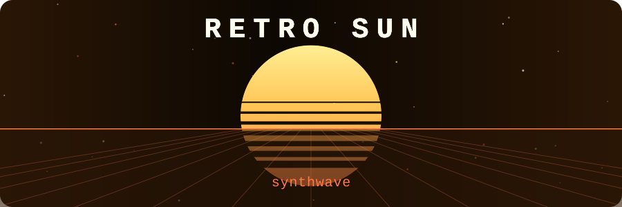
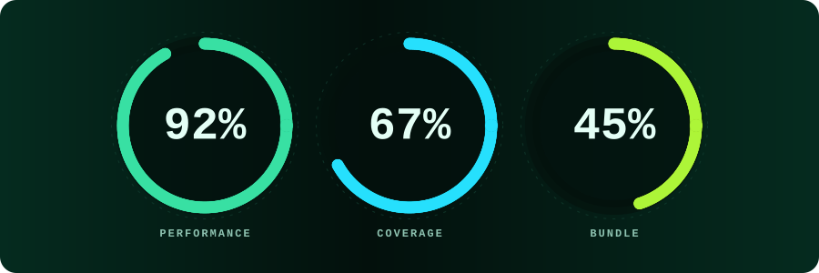

<div align="center">





**Template README.md & animasi SVG premium — satu situs, dua klik, README kamu langsung hidup.**

[](https://github.com/superrrkyy/nexsolarix/actions/workflows/ci.yml)
[](https://nodejs.org)
[](https://vite.dev)
[](./LICENSE)

[Indonesia](#daftar-isi) · [English](#english-summary)

</div>

NexSolarix adalah studio web untuk mempercantik profil atau repo GitHub: **22 template README siap pakai** dan **37 animasi SVG** yang bisa dikustomisasi langsung di browser, lalu disalin sebagai teks atau diunduh sebagai ZIP lengkap (README.md + file animasi) yang bebas kamu ubah.

> Semua animasi tetap berjalan di GitHub karena ditaruh **di dalam file SVG**, bukan di markdown — lihat [Mengapa animasinya jalan](#mengapa-animasinya-jalan-di-github).



## Daftar isi

- [Fitur](#fitur)
- [Galeri animasi](#galeri-animasi)
- [Instalasi lengkap](#instalasi-lengkap)
  - [1. Prasyarat](#1-prasyarat)
  - [2. Ambil source code](#2-ambil-source-code)
  - [3. Install dependency](#3-install-dependency)
  - [4. Konfigurasi environment (opsional)](#4-konfigurasi-environment-opsional)
  - [5. Jalankan mode development](#5-jalankan-mode-development)
  - [6. Build produksi & preview](#6-build-produksi--preview)
  - [7. Verifikasi instalasi](#7-verifikasi-instalasi)
  - [Update & uninstall](#update--uninstall)
- [Perintah npm](#perintah-npm)
- [Cara pakai singkat](#cara-pakai-singkat)
- [Struktur proyek](#struktur-proyek)
- [Source code inti](#source-code-inti)
- [Mengapa animasinya jalan di GitHub](#mengapa-animasinya-jalan-di-github)
- [Sistem premium & kode lisensi](#sistem-premium--kode-lisensi)
- [Efek samping & batasan](#efek-samping--batasan)
- [Error umum & cara memperbaikinya](#error-umum--cara-memperbaikinya)
- [Deploy](#deploy)
- [Pengujian](#pengujian)
- [Menambah animasi atau template baru](#menambah-animasi-atau-template-baru)
- [Lisensi](#lisensi)

---

## Fitur

**Konten**
- 22 template README: 12 gratis + 10 premium (profil, proyek, portofolio, kreatif, minimal, data).
- 37 animasi SVG: 25 gratis + 12 premium (banner, kartu, data, efek, pemisah).
- 18 palet warna terkurasi (10 gratis + 8 signature premium) plus input warna aksen bebas.
- Setiap template = `README.md` + folder `assets/` berisi file `.svg` + `nexsolarix.config.json` + `HOW-TO.md` (panduan dua bahasa).

**Interaksi**
- Kustomisasi langsung: palet, warna aksen, ukuran, kecepatan, kerapatan elemen, radius, font, perataan, glow, latar transparan, dan semua teks.
- Preview real-time dalam bingkai mirip GitHub, lengkap dengan toggle tampilan terang/gelap.
- Salin teks README, salin kode SVG per aset, unduh README saja, atau unduh ZIP lengkap.
- Dua mode tautan aset: **relatif** (file di repo yang sama) atau **URL mentah GitHub** (aset di repo lain).
- Command palette (`⌘K` / `Ctrl+K`) untuk lompat ke template, animasi, atau halaman mana pun.
- Pencarian, filter tier/kategori/jenis, urutkan, acak, dan daftar favorit (tersimpan lokal).
- Bilingual **Indonesia / English** dengan toggle, mode **terang/gelap**, PWA + service worker (bisa dibuka offline).

**Teknis**
- React 19 + Vite 6 + TypeScript strict. Tanpa backend, tanpa database, tanpa API key.
- Penulis ZIP sendiri (memakai `CompressionStream('deflate-raw')`, fallback ke STORE) — nol dependency eksternal untuk aset.
- 358 tes: validasi setiap SVG (referensi `url(#id)` harus resolve, tanpa `<script>`, durasi valid), audit tata letak teks, struktur ZIP + CRC32, kebijakan salin/unduh, algoritme kode lisensi, dan smoke test semua halaman — termasuk uji runtime di DOM (jsdom) untuk halaman detail, kunci premium, tab README, filter galeri, dan command palette.

---

## Galeri animasi

Semua preview di bawah ini **adalah file SVG hidup** yang sama persis dengan yang dihasilkan situs — regenerasinya dari registry animasi, jadi tidak akan pernah beda dengan produk aslinya.

<table>
  <tr>
    <td align="center"><br /><sub><b>Aurora Flow</b> · premium</sub></td>
    <td align="center"><br /><sub><b>Holo Card</b> · premium</sub></td>
  </tr>
  <tr>
    <td align="center"><br /><sub><b>Kinetic Typography</b> · premium</sub></td>
    <td align="center"><br /><sub><b>Retro Sun</b> · premium</sub></td>
  </tr>
  <tr>
    <td align="center"><br /><sub><b>IDE Window</b> · premium</sub></td>
    <td align="center"><br /><sub><b>Stat Rings Pro</b> · premium</sub></td>
  </tr>
</table>


---

## Instalasi lengkap

Semua source code ada di repository ini — tidak ada package privat, tidak perlu API key, tidak perlu akun cloud. Cukup Node.js dan npm.

### 1. Prasyarat

| Kebutuhan | Versi minimum | Cek di terminal |
| --- | --- | --- |
| Node.js | 20 (CI memakai 22) | `node -v` |
| npm | 10 | `npm -v` |
| Git | opsional, untuk clone | `git --version` |
| Browser modern | Chrome/Edge/Firefox/Safari 2 tahun terakhir | — |

Belum punya Node? Pasang lewat [nodejs.org](https://nodejs.org) (LTS), atau lewat version manager:

```bash
# contoh dengan nvm
nvm install 22
nvm use 22
```

### 2. Ambil source code

**Opsi A — Git (disarankan, mudah di-update):**

```bash
git clone https://github.com/superrrkyy/nexsolarix.git
cd nexsolarix
```

**Opsi B — ZIP tanpa Git:** tombol **Code → Download ZIP** di halaman repository, lalu ekstrak dan `cd` ke folder hasil ekstrak.

> Mau fork dulu? Boleh — `gh repo fork superrrkyy/nexsolarix --clone` atau klik **Fork** di GitHub, lalu clone repo fork kamu.

### 3. Install dependency

```bash
npm install
```

Ini memasang React 19, Vite 6, TypeScript, dan vitest ke `node_modules/`. Perintah `npm ci` juga bisa dipakai (lebih ketat, sinkron dengan `package-lock.json`) — cocok untuk CI.

### 4. Konfigurasi environment (opsional)

Salin `.env.example` menjadi `.env.local`, lalu isi yang perlu saja — **semuanya opsional**:

```bash
cp .env.example .env.local
```

| Variabel | Fungsi | Default |
| --- | --- | --- |
| `VITE_INSTAGRAM_HANDLE` | Handle Instagram owner untuk CTA premium (tanpa `@`). | `superryinz` |
| `VITE_LICENSE_SECRET` | Secret untuk menandatangani kode lisensi. Kosong = memakai demo secret bawaan. | (demo) |
| `VITE_SITE_URL` | URL absolut situs (untuk tag canonical/OG). | — |
| `VITE_BASE` | Base path saat di-host di sub-folder, misal `/nexsolarix/`. | `/` |

> Perubahan `.env` baru terbaca setelah dev server / build dijalankan ulang.

### 5. Jalankan mode development

```bash
npm run dev
```

Buka **http://localhost:5173** — hot reload aktif, jadi edit apa pun langsung terlihat.

### 6. Build produksi & preview

```bash
npm run build        # typecheck strict + build ke dist/
npm run preview      # sajikan hasil build di http://localhost:4173
```

Output build ada di `dist/` — murni statis (HTML + JS + CSS + aset + service worker), bisa ditaruh di hosting mana pun.

### 7. Verifikasi instalasi

Pastikan semuanya sehat:

```bash
npm run typecheck    # harus diam-diam sukses
npm test             # harus 358 tes hijau
npm run audit:layout # audit tata letak teks semua animasi & template
```

### Update & uninstall

```bash
# update ke versi terbaru
git pull
npm install

# uninstall — hapus folder proyek saja; tidak ada data yang ditulis ke luar folder.
# Jika situs sudah pernah dibuka sebagai PWA: hapus juga "NexSolarix" dari
# daftar aplikasi/Service Worker di DevTools browser.
```

---

## Perintah npm

| Perintah | Fungsi |
| --- | --- |
| `npm run dev` | Dev server + hot reload di `http://localhost:5173` |
| `npm run build` | Typecheck + build produksi ke `dist/` |
| `npm run preview` | Jalankan hasil build di `http://localhost:4173` |
| `npm run typecheck` | TypeScript strict tanpa emit |
| `npm test` | 358 tes (vitest, satu kali jalan) |
| `npm run test:watch` | Tes mode watch |
| `npm run audit:layout` | Audit tata letak teks semua animasi + template |
| `npm run samples` | Render semua aset ke `./samples` untuk diperiksa |
| `npm run zips` | Tulis ZIP sungguhan per template ke `./samples/zips` |
| `npm run readme:assets` | Regenerasi aset animasi README di `docs/assets/` |

---

## Cara pakai singkat



1. Buka situs, pilih **template** (atau **animasi** satuan) di galeri.
2. Kustomisasi di panel kanan: palet, aksen, ukuran, kecepatan, teks, font, glow.
3. Pilih mode tautan aset: **relatif** (`./assets/x.svg`) untuk file di repo kamu, atau **URL mentah GitHub** kalau asetnya kamu host di repo lain.
4. Klik **Salin** untuk menempelkan `README.md` ke repo kamu, atau **Unduh ZIP** untuk mendapat paket lengkap:
   ```text
   README.md
   assets/            ← semua file .svg animasi
   nexsolarix.config.json
   HOW-TO.md          ← panduan (ID + EN)
   ```
5. Commit — animasi langsung hidup di GitHub.

---

## Struktur proyek

```text
src/
  core/
    types.ts          Tipe domain (RenderConfig, AnimationAsset, TemplateAsset…)
    palettes.ts       18 palet + config default + resolver
    site.ts           Metadata brand & statistik situs
  lib/
    svgkit.ts         Toolkit SVG: builder, konteks render, komposit (blob, partikel, equalizer…)
    markdown.ts       Renderer markdown mini untuk preview (escape-first + whitelist tag)
    zip.ts            Penulis ZIP tanpa dependency (DEFLATE + fallback STORE)
    license.ts        Pembuatan & validasi kode lisensi
    exporter.ts       Bangun file template, unduh ZIP/SVG/CSV, util data URI
    hash.ts           CRC32, FNV-1a, obfuscate
  animations/
    banners.ts        banner    · aurora, starfield, neon grid, shimmer, dot matrix
    cards.ts          kartu     · terminal, profil, glass, HUD, quote, code
    data.ts           data      · skill bars, equalizer, loading, badges, ring stats
    effects.ts        efek      · constellation, radar, matrix, pulse rings, sparkle
    dividers.ts       pemisah   · wave, pulse line, marquee, orbit
    premium.ts        premium   · holo card, aurora flow, glitch, kinetic, liquid metal,
                                  retro sun, dashboard, stat rings, IDE window, particle
                                  depth, nebula, prism
  templates/
    free.ts           12 template gratis
    premium.ts        10 template premium
    shared.ts         Blok penulisan markdown + perakitan file ZIP
  components/         AppShell, CommandPalette, Customizer, SvgPreview, kartu, UI kit
  pages/              Home, Templates, TemplateDetail, Animations, AnimationDetail,
                      Premium, Guide, Owner, 404
  styles/             tokens.css, base.css, components.css, pages.css
  i18n/               Kamus Indonesia & Inggris
tools/                Skrip bantu pengembangan: render contoh, audit tata letak,
                      tulis ZIP nyata, smoke HTTP, regen aset README
docs/assets/          Aset animasi yang dipakai README ini (dihasilkan npm run readme:assets)
```

---

## Source code inti

Repository ini **adalah** source code-nya — lengkap, tanpa yang disembunyikan. Di bawah ini potongan-potongan kuncinya supaya kamu langsung paham cara kerjanya.

### 1. Satu animasi = satu objek (`src/animations/banners.ts`)

Setiap animasi didefinisikan dengan `defineAnimation()`: metadata bilingual + fungsi `body` yang menghasilkan markup SVG. Contoh asli — `aurora-banner` (dipotong):

```ts
export const auroraBanner = defineAnimation({
  id: 'aurora-banner',
  name: { id: 'Aurora Banner', en: 'Aurora Banner' },
  blurb: {
    id: 'Pita aurora lembut yang bergerak pelan dengan judul bercahaya.',
    en: 'Soft drifting aurora ribbons behind a glowing headline.',
  },
  tier: 'free',
  group: 'banner',
  tags: ['banner', 'aurora', 'gradient', 'headline'],
  aria: 'Animated aurora banner with a glowing headline',
  defaults: { height: 260 },
  body: (x) => {
    const blobs = [
      softBlob(x, { cx: x.W * 0.22, cy: x.H * 0.32, r: x.H * 0.62, color: x.g1, opacity: 0.5, dur: 9 }),
      softBlob(x, { cx: x.W * 0.68, cy: x.H * 0.62, r: x.H * 0.7,  color: x.g2, opacity: 0.42, dur: 11 }),
      softBlob(x, { cx: x.W * 0.46, cy: x.H * 0.2,  r: x.H * 0.5,  color: x.g3, opacity: 0.34, dur: 13 }),
    ].join('');

    return [
      blobs,
      x.vignette(0.45),
      x.heading(x.config.title, { y: x.H * 0.5 }),
      x.subtitleText(x.config.subtitle, { y: x.H * 0.68 }),
      x.labelText(x.config.label, { y: x.H * 0.84 }),
    ].join('');
  },
});
```

### 2. Primitif SVG-nya (`src/lib/svgkit.ts`)

Semua aset dibangun dari helper kecil yang menghasilkan string SVG — inilah alasan animasinya aman: hanya SMIL, tanpa `<script>`, tanpa URL eksternal:

```ts
export function h(tag: string, values: Record<string, AttrValue> = {}, kids: string | string[] = ''): string {
  const body = Array.isArray(kids) ? kids.join('') : kids;
  if (!body) return `<${tag}${attrs(values)}/>`;
  return `<${tag}${attrs(values)}>${body}</${tag}>`;
}

export function animate(attributeName: string, options: AnimateOptions): string {
  return h('animate', {
    attributeName,
    dur: options.dur,
    begin: options.begin ?? '0s',
    repeatCount: options.repeatCount ?? 'indefinite',
    values: options.values,
    // …calcMode, keyTimes, keySplines, fill
  });
}
```

Dipakai kira-kira begini:

```ts
h('rect', { x: 0, y: 120, width: 600, height: 3, fill: x.g2 }, [
  animate('width', { dur: '3s', values: '0;600', repeatCount: 'indefinite' }),
].join(''));
```

### 3. Registrasi (`src/animations/index.ts`)

Animasi baru cukup didaftarkan — tes otomatis langsung menyusul:

```ts
export const FREE_ANIMATIONS: AnimationAsset[] = [
  auroraBanner, starfield, neonGrid, gradientShimmer, dotMatrix,
  terminalType, profileCard, /* …25 animasi gratis */
];
export const ALL_ANIMATIONS: AnimationAsset[] = [...FREE_ANIMATIONS, ...premiumAnimations];
```

### 4. Penulis ZIP tanpa dependency (`src/lib/zip.ts`)

ZIP template dibangun byte-per-byte di browser (header lokal + central directory + EOCD, lengkap dengan CRC32):

```ts
export async function createZip(entries: ZipEntry[], options: ZipOptions = {}): Promise<Uint8Array> {
  for (const entry of entries) {
    const raw = typeof entry.content === 'string' ? encoder.encode(entry.content) : entry.content;
    let method = 0;
    let stored = raw;
    if (compress && raw.length > 64) {
      const deflated = await deflateRaw(raw);   // CompressionStream('deflate-raw')
      if (deflated && deflated.length < raw.length) {
        method = 8;                             // DEFLATE
        stored = deflated;
      }                                          // gagal → method 0 (STORE)
    }
    const crc = crc32(raw);
    // …tulis header lokal, kumpulkan central directory, tulis EOCD
  }
}
```

### 5. Kode lisensi (`src/lib/license.ts`)

```ts
export const LICENSE_ALPHABET = 'ABCDEFGHJKLMNPQRSTUVWXYZ23456789'; // tanpa I, O, 0, 1

/** Deterministic 4-character signature for a payload. */
export function signPayload(secret: string, payload: string): string {
  let out = '';
  for (let i = 0; i < 4; i += 1) {
    const digest = fnv1a(`${secret}:${payload}:${i}`, 0x811c9dc5 ^ (i * 0x9e3779b9));
    out += indexToChar(digest);
  }
  return out;
}
```

Format akhir: `NXS-XXXX-XXXX-XXXX` — karakter pertama payload menandai paket (`P` = Pro, `S` = Studio).

### 6. Blok markdown template (`src/templates/shared.ts`)

```ts
export function img(asset: SvgAsset | undefined, alt: string, width = '100%'): string {
  if (!asset) return '';
  return ``;
}
```

### 7. Memakai hasilnya di README kamu

Hasil ekspor template (atau aset apa pun dari galeri) cukup ditaruh sebagai `` biasa — **jangan** menyisipkan SVG mentah ke markdown:

```html

```

Atau dengan URL mentah GitHub kalau asetnya di repo lain:

```html

```

### 8. Aset animasi README ini sendiri

Banner, badge, pemisah, dan showcase di halaman ini dihasilkan oleh `tools/readme-assets.ts` dari registry animasi yang sama:

```bash
npm run readme:assets   # → docs/assets/*.svg
```

---

## Mengapa animasinya jalan di GitHub

GitHub menyanitasi HTML di README: `<script>` dan `<style>` dihapus, begitu juga sebagian besar `class`/`id`. Tapi `` diperlakukan sebagai gambar biasa — dan browser merender isi SVG itu **lengkap**, termasuk animasi SMIL di dalamnya.

Konsekuensinya, semua animasi NexSolarix:

- disimpan sebagai file `.svg` mandiri (bukan CSS di README);
- hanya memakai SMIL (`<animate>`, `<animateTransform>`) dan CSS di dalam file SVG;
- tidak memuat sumber eksternal, tidak menjalankan script, tidak bisa membaca data pengunjung;
- semua `id` di-namespace per render sehingga beberapa aset aman ditampilkan bersamaan.

---

## Sistem premium & kode lisensi

Alur jual-beli sepenuhnya manual lewat Instagram — situs tidak menyimpan data siapa pun.

1. Pengunjung membuka halaman **Premium** lalu klik tombol menuju Instagram owner (**[@superryinz](https://instagram.com/superryinz)**).
2. Setelah pembayaran, owner membuat kode di halaman tersembunyi **`/owner`**.
3. Pembeli menempelkan kode di halaman Premium; konten premium terbuka dan tersimpan di browser itu.

**Format kode:** `NXS-XXXX-XXXX-XXXX`
- karakter pertama payload menandakan paket: `P` = Pro, `S` = Studio;
- 7 karakter berikutnya acak (memakai `crypto.getRandomValues`);
- 4 karakter terakhir adalah tanda tangan dari `secret + payload`;
- alfabetnya membuang `I`, `O`, `0`, `1` supaya aman diketik ulang dari chat.

### Membuat kode sebagai owner

```bash
# 1. Tentukan secret pribadi, lalu build dengan secret itu
printf 'VITE_LICENSE_SECRET=rahasia-panjang-kamu\n' > .env.local
npm run build

# 2. Jalankan /owner di browser, ketik secret yang sama, pilih paket, generate.
#    Kode yang dihasilkan langsung valid untuk build tersebut.
```

Halaman `/owner` menghitung semuanya di browser — secret yang kamu ketik **tidak dikirim ke mana pun**.

### Catatan keamanan (jujur)

Karena situs ini murni statis, validasi kode berjalan di browser. Artinya:

- ini **soft gate** — orang yang membongkar bundle bisa memulihkan secret dan membuat kode sendiri;
- dengan `VITE_LICENSE_SECRET` diset saat build, secret bawaan demo tidak lagi dipakai dan kode publik tidak otomatis valid, tapi secret tetap bisa diekstrak dari bundle;
- ruang tanda tangan 4 karakter (≈2²⁰) cukup untuk mencegah coba-coba manual, bukan untuk melawan script;
- kalau kamu butuh penegakan keras (kode terikat akun/perangkat, bisa dicabut), itu perlu backend — dan itu keputusan produk yang terpisah.

Yang **tidak** dilakukan NexSolarix: mengirim data pembeli ke server, menyimpan kode di database, atau memasang pelacak.

Template & animasi gratis boleh dipakai, diubah, dan disebarkan — termasuk untuk proyek komersial — tanpa wajib mencantumkan kredit. Koleksi ini tidak boleh dijual ulang sebagai produk.


---

## Efek samping & batasan

Jujur saja — mempercantik README dengan animasi SVG punya konsekuensi. Ini daftarnya, plus mitigasinya:

**Performa**
- Setiap `` yang beranimasi menghabiskan sedikit CPU/GPU terus-menerus (SMIL tidak otomatis berhenti saat tab di belakang). Di README dengan 10+ animasi, laptop lama bisa terasa hangat dan baterai lebih boros.
- **Mitigasi:** batasi 3–6 animasi per README (hero + 1–2 pemisah + beberapa kartu sudah cukup). Pakai file statis (`.png`/`.svg` tanpa `<animate>`) untuk konten yang tidak perlu bergerak.

**Aksesibilitas**
- Teks di dalam SVG tidak bisa diseleksi, dicari (`Ctrl+F`), atau diterjemahkan tools; pembaca layar hanya mendengar `aria-label`/`<title>`.
- Animasi SMIL **mengabaikan** preferensi `prefers-reduced-motion` sistem — pengguna yang sensitif gerakan tetap melihat animasinya.
- **Mitigasi:** jangan pernah menaruh informasi penting hanya di dalam SVG animasi; selalu sediakan teks markdown biasa sebagai konten utama, dan pertimbangkan versi statis di `<details>` untuk pengguna yang membutuhkan.

**Cache & CDN**
- GitHub menyajikan gambar README lewat proxy camo dengan cache agresif. Kalau kamu mengganti isi file `.svg` **dengan nama yang sama**, perubahan bisa tertunda beberapa menit–jam di sebagian pengunjung.
- **Mitigasi:** setelah mengubah aset, tambahkan versi di query string (`banner.svg?v=2`) atau ganti nama file — atau tunggu cache habis.

**Kompatibilitas**
- Animasi hidup penuh di GitHub, GitLab, dan browser modern. Di preview VS Code, email client, npmjs, atau markdown viewer yang mem-bake SVG ke raster, kamu mungkin melihat **frame pertama saja** (tetap terlihat bagus, tapi diam).
- Cetak/PDF/screenshot = frame statis. Itu memang perilaku normal SMIL.

**Service worker / PWA**
- Setelah update build, pengunjung lama bisa melihat versi lama sampai service worker mengganti cache.
- **Mitigasi:** hard refresh (`Ctrl+Shift+R`) atau unregister service worker dari DevTools → Application → Service Workers.

**Keamanan & lisensi**
- Gerbang premium adalah soft gate di sisi klien (lihat [catatan keamanan](#catatan-keamanan-jujur)) — bukan DRM keras.
- File SVG NexSolarix bebas script & sumber eksternal; tetap saja, audit SVG pihak ketiga sebelum dipakai di README kamu sendiri.

---

## Error umum & cara memperbaikinya

| # | Gejala / pesan error | Penyebab | Cara memperbaiki |
| --- | --- | --- | --- |
| 1 | `npm ERR! engine Unsupported engine` / `EBADENGINE` | Node.js < 20 | Upgrade Node: `node -v` harus ≥ 20. Pakai `nvm install 22 && nvm use 22` atau installer nodejs.org LTS. |
| 2 | `EADDRINUSE: address already in use :::5173` | Port dev server sudah dipakai proses lain | Matikan proses lama, atau jalankan di port lain: `npm run dev -- --port 5174`. |
| 3 | `vite: not found` / `tsc: not found` / `vitest: not found` | Dependency belum terinstall atau `node_modules` rusak | `npm install`. Masih gagal? hapus `node_modules` lalu `npm ci`. |
| 4 | `npm ci` error `EUSAGE` / lockfile tidak sinkron | `package-lock.json` tidak cocok dengan `package.json` | Pakai `npm install` (sinkron), lalu commit `package-lock.json` yang baru. |
| 5 | `npm run build` gagal dengan error TS#### | Ada pelanggaran tipe TypeScript setelah kamu mengedit | Jalankan `npm run typecheck`, perbaiki lokasi yang disebut; mode strict memang disengaja. |
| 6 | Gambar animasi tidak muncul di README (ikon rusak) | Path salah atau file `.svg` belum ikut ter-commit | Gunakan path relatif benar (`./assets/nama.svg` — huruf besar/kecil harus sama), lalu `git add assets/ && git commit`. |
| 7 | Animasi tidak berjalan — tampil diam/flat | (a) cache GitHub/camo menyajikan versi lama; (b) file ternyata `.png`/`.gif`, bukan `.svg`; (c) markdown viewer non-GitHub; (d) browser sangat lama | Hard refresh atau tambah `?v=2` di URL; pastikan file asli `.svg` berisi SMIL (`<animate>`); buka di browser modern. Lihat [efek samping](#efek-samping--batasan). |
| 8 | Deploy GitHub Pages: aset 404 (halaman tampil tapi gambar/JS hilang) | Base path salah — build untuk `/` padahal situs di `/nama-repo/` | Build ulang dengan `VITE_BASE=/nama-repo/ npm run build` (workflow `deploy-pages.yml` sudah menyetelnya otomatis). |
| 9 | Refresh di halaman dalam (mis. `/premium`) memberi 404 di hosting statis | Hosting tanpa rewrite SPA | Pakai `public/404.html` (sudah disediakan) untuk GitHub Pages, atau pastikan `vercel.json`/`netlify.toml` terbawa deploy. |
| 10 | Kode lisensi ditolak: `Kode tidak valid` | (a) salah ketik huruf ganda; (b) kode dibuat dengan secret build lain; (c) kode untuk paket berbeda | Salin-tempel utuh (format `NXS-XXXX-XXXX-XXXX`, alfabet tanpa `I O 0 1`); generate ulang via `/owner` dengan secret yang **sama** seperti saat `npm run build`. |
| 11 | Halaman `/owner` tidak ketemu | Halaman memang disembunyikan dari navigasi | Buka langsung `https://situs-kamu/owner` di address bar. |
| 12 | ZIP terunduh tapi kosong / ditolak extractor | Ekstensi browser yang mengubah unduhan, atau browser lama tanpa `CompressionStream` (tetap valid, tapi tanpa kompresi) | Nonaktifkan ekstensi pemblokir unduhan; coba Chrome/Firefox terbaru; verifikasi dengan `unzip -t file.zip` atau `npm run zips` lalu cek `samples/zips/`. |
| 13 | Situs masih menampilkan versi lama setelah update | Cache service worker PWA | DevTools → Application → Service Workers → **Unregister**, lalu hard refresh. |
| 14 | `npm test` gagal setelah menambah animasi baru | Tes memvalidasi: `url(#id)` harus resolve, tanpa `<script>`, durasi > 0 & masuk akal, teks tidak keluar kanvas, bilingual lengkap | Baca pesan kegagalan tes — biasanya menyebut id/dimensi yang bermasalah. Jalankan `npm run audit:layout` untuk detail tata letak. |
| 15 | Windows: `npm.ps1 cannot be loaded` / running scripts disabled | Execution policy PowerShell | Pakai `npm.cmd run dev` dari cmd, atau `Set-ExecutionPolicy -Scope CurrentUser RemoteSigned`. |
| 16 | `git clone` gagal `Authentication failed` | Repo privat / kredensial belum ada | Untuk repo publik ini gunakan URL HTTPS tanpa kredensial. Untuk fork privat, autentikasi GitHub lewat aplikasi/`gh auth login` di mesin kamu — jangan pernah menempelkan token ke URL. |
| 17 | Font di animasi terlihat beda antar perangkat | SVG memakai font stack sistem (`JetBrains Mono`, `Inter`, dll.) | Wajar — fallback berbeda per OS. Untuk tampilan seragam, pilih font `mono`/`sans` di kustomisator (paling stabil). |
| 18 | `npm run samples` / `zips` / `readme:assets` error `vite-node: not found` | Dev dependency belum terinstall (baru `npm ci --omit=dev`?) | `npm install` lengkap — skrip ini memang butuh devDependencies. |

Masih buntu? Buka [issue](https://github.com/superrrkyy/nexsolarix/issues) dengan: OS, `node -v`, perintah yang dijalankan, dan pesan error lengkap.

---

## Deploy

Situs ini statis; build-nya (`dist/`) bisa ditaruh di mana saja.

**Vercel / Netlify** — sudah ada `vercel.json` dan `netlify.toml` dengan rewrite SPA.

**Cloudflare Pages / hosting statis lain** — build command `npm run build`, output `dist/`.

**GitHub Pages** (di sub-folder, misal `username.github.io/nexsolarix/`):

```bash
VITE_BASE=/nexsolarix/ npm run build
```

Lihat `.github/workflows/deploy-pages.yml` untuk alur otomatis, dan `public/404.html` yang menangani deep link pada hosting statis tanpa rewrite.

Untuk produksi yang serius, set `VITE_LICENSE_SECRET` di environment CI (GitHub Actions secret) supaya kode demo publik tidak berlaku di build kamu.

---

## Pengujian

```bash
npm test
```

Yang diperiksa (358 tes):

| Berkas | Cakupan |
| --- | --- |
| `src/animations/animations.test.ts` | 37 animasi × validitas SVG, referensi id, dimensi, transparansi, semua palet; 22 template × kelengkapan file & tautan aset |
| `src/animations/layout.test.ts` | Audit tata letak: tidak ada teks yang keluar kanvas atau bertabrakan, di tiga ukuran (kecil, default, besar), untuk animasi maupun aset di dalam template |
| `src/lib/zip.test.ts` | Struktur ZIP, CRC32, ukuran, kompresi, nama non-latin, arsip kosong |
| — (verifikasi manual) | 22 ZIP nyata ditulis ke disk lalu diperiksa dengan `zipfile` Python: CRC setiap entri benar, semua tautan `./assets/*.svg` ada di dalam arsip, dan tidak ada SVG inline yang bocor ke teks README |
| `src/lib/license.test.ts` | Format kode, tier, normalisasi input, penolakan kode palsu, keunikan |
| `src/app/acceptance.test.tsx` | Aturan produk: "copy" hanya teks README.md (tanpa SVG inline), ZIP berisi README + semua file animasi, skala ukuran proporsional, dan kunci premium |
| `src/app/pages.test.tsx` | Smoke test semua halaman lewat SSR, penguncian premium, keamanan renderer markdown |
| `src/app/runtime.test.tsx` | Aplikasi asli di-mount di DOM: rute lazy, filter galeri, tab README, ganti tema/bahasa, kunci premium, palette ⌘K, 404 |
| `src/i18n/i18n.test.ts` | Kedua kamus punya kunci yang sama, tidak ada terjemahan kosong, placeholder konsisten, dan setiap `t('...')` di kode benar-benar ada |

---

## Menambah animasi atau template baru

Animasi baru cukup satu objek di `src/animations/`:

```ts
import { defineAnimation, softBlob, h, animate, textEl } from '../lib/svgkit';

export const myAnimation = defineAnimation({
  id: 'my-animation',
  name: { id: 'Animasi Saya', en: 'My Animation' },
  blurb: { id: 'Deskripsi singkat.', en: 'Short description.' },
  tier: 'free',
  group: 'banner',
  tags: ['banner', 'demo'],
  aria: 'Animated demo banner',
  defaults: { height: 240 },
  body: (x) => [
    softBlob(x, { cx: x.W * 0.3, cy: x.H * 0.5, r: x.H * 0.6, color: x.g1, dur: 9 }),
    textEl(x.config.title, { x: x.anchorX(), y: x.H * 0.55, size: x.dev(40, 'h'), fill: x.text, font: x.font, weight: 800 }),
    h('rect', { x: 0, y: x.H * 0.7, width: x.W, height: 3, fill: x.g2 }, [
      animate('width', { dur: x.dur(3), values: `0;${x.W}`, repeatCount: 'indefinite' }),
    ].join('')),
  ].join(''),
});
```

Lalu daftarkan di `src/animations/index.ts`. Tes akan otomatis memvalidasi: SVG valid, semua `url(#id)` resolve, tidak ada `<script>`, durasi masuk akal, dan berjalan di semua palet.

Template baru dibuat dengan memanggil `buildFiles()` di `src/templates/shared.ts` dan mengisi blok markdown — lihat `src/templates/free.ts` sebagai contoh. Semua template wajib bilingual (`name` dan `blurb` dalam `id` dan `en`).

---

## English summary

NexSolarix is a web studio for beautiful GitHub READMEs: **22 ready-to-use README templates** and **37 animated SVG assets** you can customize in the browser, then copy as text or download as a full ZIP (README.md + SVG files). Animations work on GitHub because they live **inside standalone SVG files** (SMIL only — no scripts, no external sources).

- **Install:** Node 20+ → `git clone` → `npm install` → `npm run dev` (http://localhost:5173).
- **Test:** `npm test` — 358 tests green. **Build:** `npm run build` → static `dist/`.
- **Side effects & limits:** animated SVGs cost a little CPU, ignore `prefers-reduced-motion`, and get cached by GitHub's image proxy — keep 3–6 animations per README and keep real content in plain markdown.
- **Errors:** see the [troubleshooting table](#error-umum--cara-memperbaikinya) above (engine errors, ports, license keys, GitHub Pages base path, service-worker cache, …).
- Premium is unlocked with `NXS-XXXX-XXXX-XXXX` keys minted on the hidden `/owner` page — an honest client-side soft gate, no tracking, no backend.

---

## Lisensi

Kode sumber NexSolarix: **MIT** — lihat [LICENSE](./LICENSE).

Aset template & animasi yang dihasilkan: bebas dipakai di repo pribadi maupun komersial. Aset premium dilisensikan ke pembeli dan tidak boleh disebarkan ulang.

NexSolarix tidak berafiliasi dengan GitHub, Inc.

---

<div align="center">

Dibuat oleh [@superryinz](https://instagram.com/superryinz) · [github.com/superrrkyy/nexsolarix](https://github.com/superrrkyy/nexsolarix)


</div>
